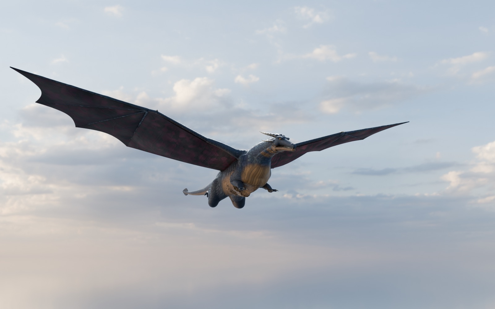
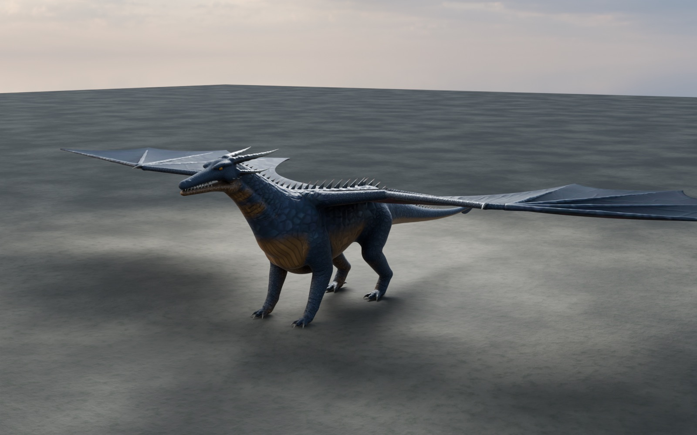
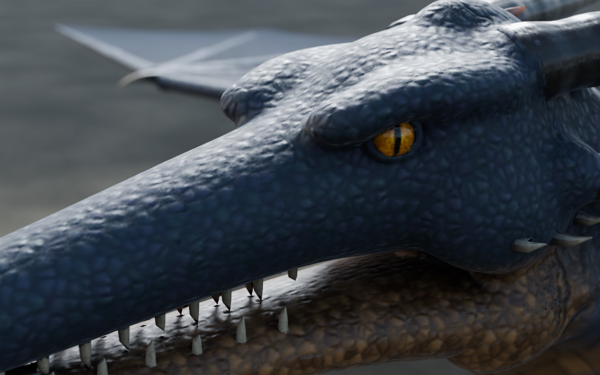
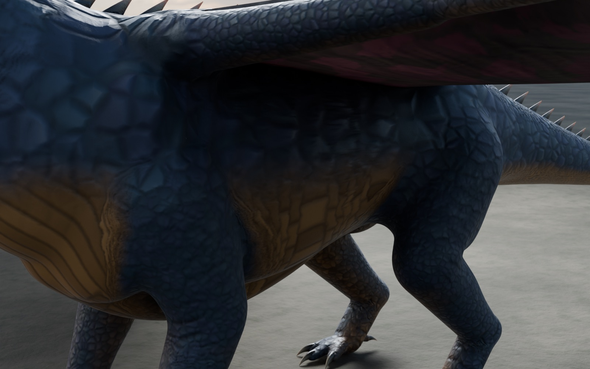
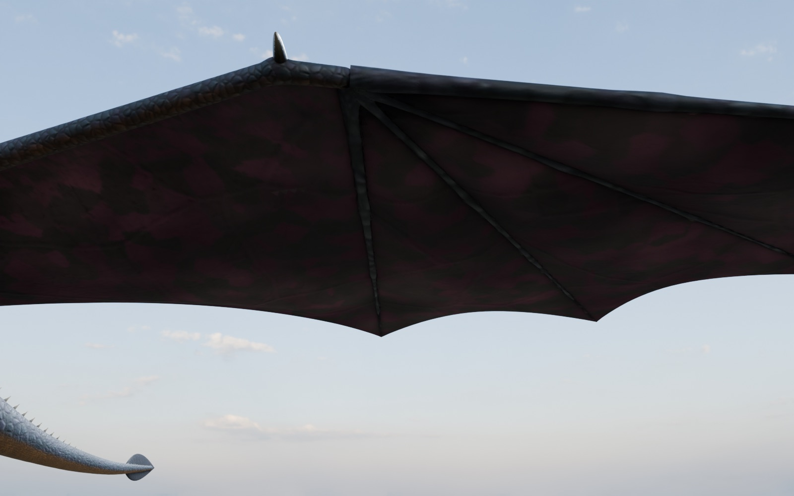

# The dragon

The game picks the dragon's look in this order:

1. `ADragonPawn::DragonAsset`, if set (any skeletal mesh).
2. `/Game/Dragon/SK_Dragon` — imported by the builder from `Data/Dragon/SK_Dragon.fbx`.
3. The primitive stand-in (`UDragonStandInComponent`), so the game always runs.

A skeletal dragon needs no animation assets: `UDragonRigComponent` drives its
bones every frame from the flight state (wingbeat, flap-glide, folding on the
ground, tail rudder, neck lean, leg swing), as the web game's rig did.

## Using a different dragon (e.g. one from Fab)

Import it, set `DragonAsset` on the pawn (or name it `/Game/Dragon/SK_Dragon`),
set `DragonMeshYaw` so it faces +X, then in the pawn's **Rig** component type its
bone names into the joints (wing shoulder/elbow/wrist per side, neck chain, head,
tail chain, four legs). Axes are in the dragon's body frame — X forward, Y right,
Z up — so they rarely need changing; flip `Sign` on a joint if it moves the wrong
way. A model that ships with real flap/glide/walk animations would look better
still; wiring those through an Animation Blueprint is a later step.

## The scripted dragon (v1)

`Tools/DragonModel/build_dragon.py` builds an original dragon procedurally in
Blender. Geometry nodes grow an 8.4M-triangle detail mesh with overlapping scales,
back plates, belly scutes, skin folds, horn rings and membrane veins. That detail
is baked into 4K maps on a 350k-triangle game mesh. The same script builds the
rig (the 50 bone names above) and computes the skin weights. A full 4K rebuild
takes about 22 minutes and peaks at about 9 GB of RAM.

* **Size:** 8.6 m nose to tail, 15.1 m wingspan. Faces UE +X, so `DragonMeshYaw = 0`.
* **Binaries:** shipped as the GitHub release **`dragon-v1`**.
  `Tools/fetch_world.py` (run by Setup.bat) unpacks `Dragon.zip`
  (FBX plus textures) into `Data/Dragon/`. `Dragon_Source.zip` holds the .blend file.
* **Materials (built by the builder):**
  * `M_DragonSkin`: subsurface shading, a faint grazing-angle sheen, and ARM maps.
  * `M_Membrane`: Two Sided Foliage, with `T_Dragon_Wing_Translucency` driving both how much light scatters through and the warm glow when the wing is back-lit by the sun.

| | |
|---|---|
|  |  |
|  |  |

**Honest verdict:** it reads as a high-quality CG creature, not a photograph.
Close-ups of the head and flank hold up under real HDRI light. The weak points,
worst first:

1. The anatomy is blended shapes, not sculpted.
2. The wing veins look blotchy.
3. The belly scutes are too regular.
4. The topology is uniform, with no hand-made edge loops at the joints.

`Data/Dragon/README.md` covers these in detail. The biggest remaining gain would
come from a sculptor working on the detail mesh, which the bake pipeline would
carry through unchanged, or from a professional Fab dragon swapped in as
described above.
